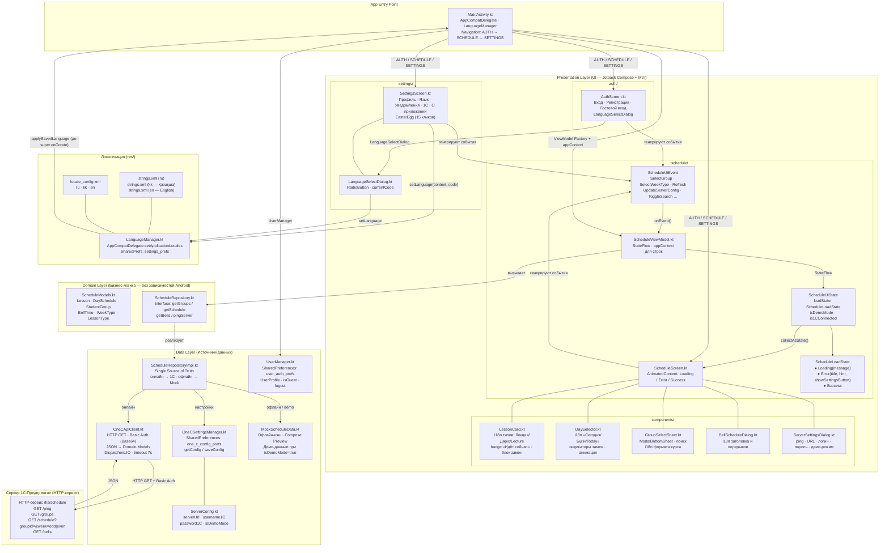
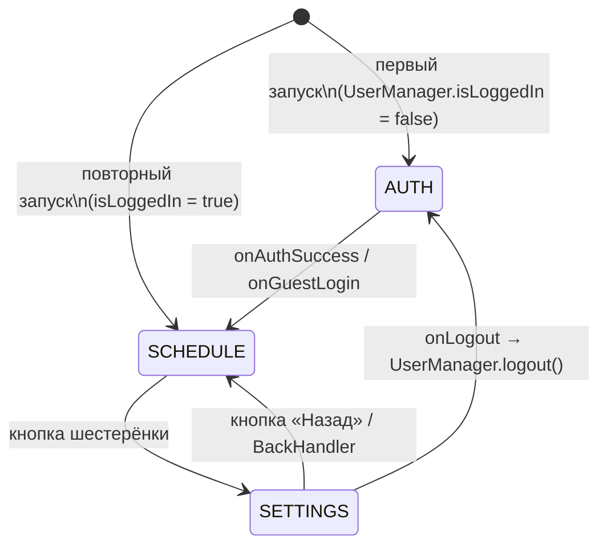
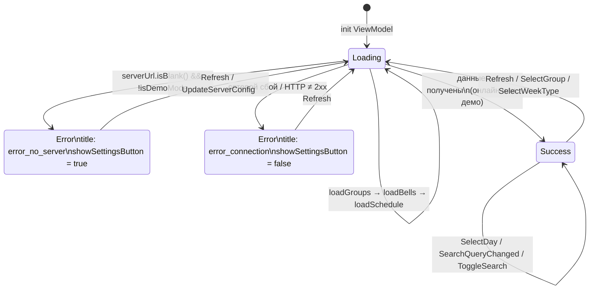
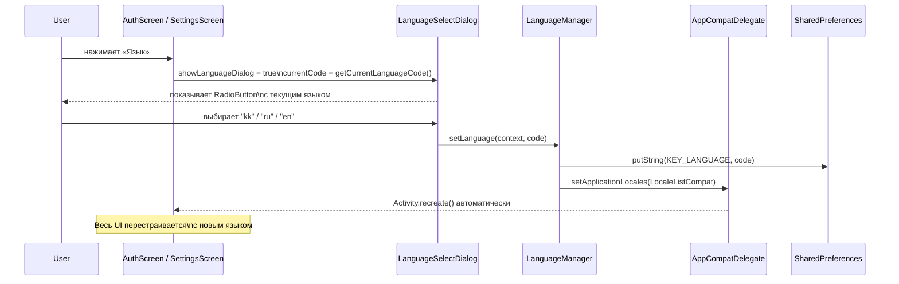

# Архитектурная схема — «Тапсырыс» (Clean Architecture + MVI/MVVM)
> Обновлено: 2026-11-01 | Версия приложения: v0.0.1-concept

---

## 1. Обзор: слои и поток данных (Unidirectional Data Flow)

---

## 2. Навигация между экранами

---

## 3. Состояния загрузки главного экрана (`ScheduleLoadState`)

---

## 4. Механизм локализации (смена языка)

---

## 5. Назначение пакетов и модулей

### 📁 `domain/` — Ядро (не зависит ни от чего Android)

| Файл | Содержимое |
|------|-----------|
| `model/ScheduleModels.kt` | `Lesson`, `DaySchedule`, `StudentGroup`, `BellTime`, `WeekType`, `LessonType` |
| `repository/ScheduleRepository.kt` | Контракт: `getGroups`, `getSchedule`, `getBells`, `pingServer` |

---

### 📁 `data/` — Источники данных

| Файл | Назначение |
|------|-----------|
| `remote/OneCApiClient.kt` | HTTP GET к 1С, `Authorization: Basic`, парсинг JSON → Domain. Timeout 7 с, `Dispatchers.IO` |
| `remote/ServerConfig.kt` | `serverUrl`, `username1C`, `password1C`, `isDemoMode` |
| `local/OneCSettingsManager.kt` | Хранение `ServerConfig` в `SharedPreferences (one_c_config_prefs)` |
| `local/UserManager.kt` | Профиль студента (`UserProfile`), флаг `isGuest`, logout |
| `mock/MockScheduleData.kt` | Офлайн-кэш и данные для Compose Preview. Используется если `isDemoMode = true` или сеть недоступна |
| `repository/ScheduleRepositoryImpl.kt` | Single Source of Truth: сначала 1С → при неудаче или `isDemoMode` → Mock |

---

### 📁 `presentation/` — UI-слой (Compose + MVI)

#### `schedule/`

| Файл | Назначение |
|------|-----------|
| `ScheduleUiState.kt` | Иммутабельное состояние: `loadState: ScheduleLoadState`, `isDemoMode`, `is1CConnected`, `groups`, `weekSchedule`, `displayLessons` |
| `ScheduleLoadState` (sealed interface) | `Loading(message)` · `Error(title, hint, showSettingsButton)` · `Success` |
| `ScheduleUiEvent` (sealed interface) | Все действия пользователя: `SelectGroup`, `Refresh`, `UpdateServerConfig` … |
| `ScheduleViewModel.kt` | Принимает `appContext: Context` для строк ресурсов. Проверяет `serverUrl` перед запросом. Управляет переходами `loadState` |
| `ScheduleScreen.kt` | `AnimatedContent` по `loadState`: спиннер загрузки → экран ошибки с Retry / Open Settings → расписание. Демо-баннер |

#### `auth/`

| Файл | Назначение |
|------|-----------|
| `AuthScreen.kt` | Вход / Регистрация / Гость. Валидация через `stringResource`. Кнопка смены языка → `LanguageSelectDialog` |

#### `settings/`

| Файл | Назначение |
|------|-----------|
| `SettingsScreen.kt` | Профиль · Язык (текущий в subtitle) · Уведомления · 1С · О приложении. Пасхалка: 15 кликов на версию |
| `LanguageSelectDialog.kt` | `RadioButton` со значком текущего языка. Параметр `currentCode` |
| `EasterEggVideoDialog.kt` | Видео-пасхалка |

#### `components/`

| Файл | Что переведено / изменено |
|------|--------------------------|
| `LessonCard.kt` | Типы занятий (`lesson_type_*`), «Идёт сейчас» (`lesson_current`), «Замена» (`lesson_replacement_label`) |
| `DaySelector.kt` | «Сегодня» (`today`) |
| `GroupSelectSheet.kt` | Заголовок, поиск, формат `course_label` |
| `BellScheduleDialog.kt` | Заголовок, длительность пары, `bell_break` |
| `ServerSettingsDialog.kt` | Диалог параметров и ping-теста 1С |

---

### 📁 `utils/`

| Файл | Назначение |
|------|-----------|
| `LanguageManager.kt` | `setLanguage(context, code)` — сохраняет в `SharedPrefs` + `AppCompatDelegate.setApplicationLocales`. **Без `recreate()`** — платформа делает сама. `getCurrentLanguageCode(context)` — для отображения выбранного языка в диалоге |

---

### 📁 `res/`

| Ресурс | Назначение |
|--------|-----------|
| `values/strings.xml` | 🇷🇺 Русский — базовый язык (70+ строк) |
| `values-kk/strings.xml` | 🇰🇿 Қазақша |
| `values-en/strings.xml` | 🇬🇧 English |
| `xml/locale_config.xml` | Декларирует поддерживаемые локали для Android 13+ (`ru`, `kk`, `en`) |
| `xml/backup_rules.xml` | Правила резервного копирования |
| `raw/musor_drop_green_screen.mp4` | Видео для пасхалки |

---

## 6. Ключевые архитектурные решения

| Решение | Обоснование |
|---------|-------------|
| **Clean Architecture (3 слоя)** | Domain не зависит от Android; легко тестировать бизнес-логику |
| **MVI (Unidirectional Data Flow)** | Один иммутабельный `UiState` → нет рассинхрона между UI-элементами |
| **`ScheduleLoadState` sealed interface** | UI отображает чёткий экран для каждого состояния (загрузка / ошибка / данные) без булевых флагов |
| **`appContext` в ViewModel** | Строки сообщений (`userMessage`, `loadState.message`) берутся из ресурсов — не хардкод, автоматически локализованы |
| **`AppCompatDelegate.setApplicationLocales`** | Смена языка без `recreate()` вручную; работает на API 24+; поддерживает системный выбор языка на API 33+ |
| **`isDemoMode` в `ServerConfig`** | По умолчанию `true` — приложение работает без реального 1С сервера «из коробки» |
| **Fallback Mock → 1С** | `ScheduleRepositoryImpl` пробует сеть, при сбое — Mock; UI видит только `Result<T>` |
