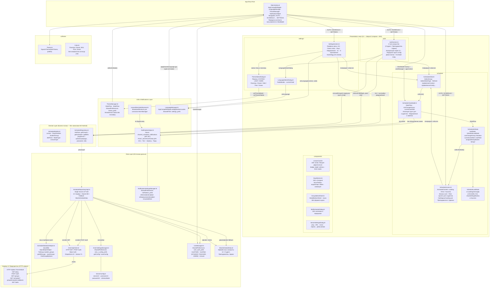
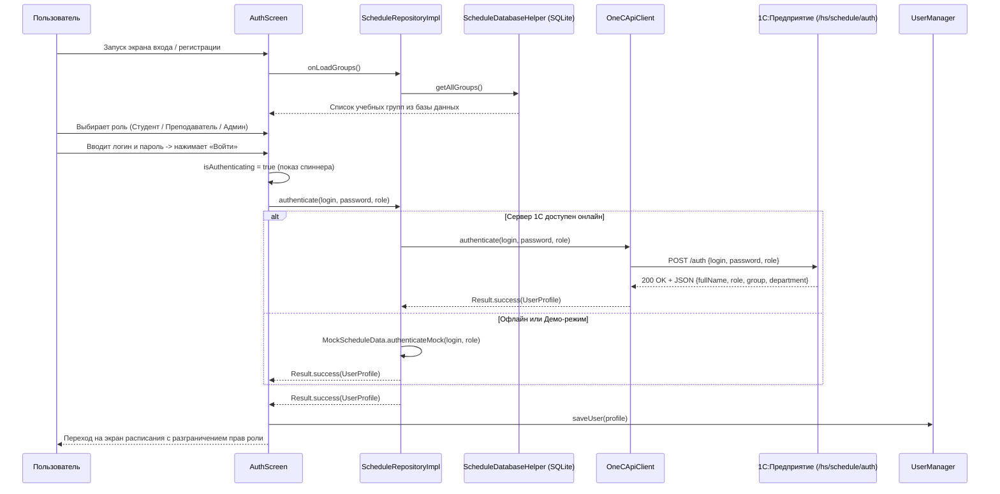
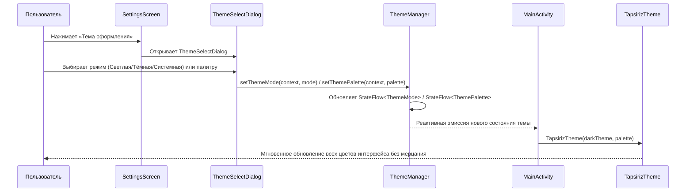

# Архитектурная схема — «Тапсырыс» (Clean Architecture + MVI/MVVM)
> Обновлено: 2026-11-07 | Версия приложения: v0.0.1-concept.4

---

## 1. Обзор: слои и поток данных (Unidirectional Data Flow)

---

## 2. Модуль учетных записей 1С (3 вида аккаунтов)

Приложение поддерживает 3 роли учетных записей, интегрированных с базой 1С:Колледж:

| Роль | `UserRole` | Описание и разграничение доступа | Тестовый логин (1С) |
|------|------------|-----------------------------------|----------------------|
| **Студент** | `STUDENT` | Просмотр расписания **строго своей группы** (жесткая привязка). Переключение чужих групп заблокировано | `student` / пароль `1234` |
| **Преподаватель** | `TEACHER` | Просмотр расписания любых групп, кафедры/отделения. Свободный выбор групп из БД | `teacher` / пароль `1234` |
| **Администратор** | `ADMINISTRATOR` | Полный доступ: управление расписанием, выбор любых групп, настройка сервера 1С | `admin` / пароль `admin` |

### Схема авторизации в базе 1С:

---

## 3. Модуль смены темы оформления

Модуль смены темы позволяет настраивать внешний вид приложения с мгновенным обновлением UI через Jetpack Compose без перезапуска Activity.

### Режимы темы (`ThemeMode`):
- `SYSTEM` — Следовать системной теме устройства (по умолчанию)
- `LIGHT` — Светлая тема
- `DARK` — Тёмная тема

### Цветовые палитры (`ThemePalette`):
- **Классическая** (`DEFAULT`) — Indigo / Deep Purple
- **Изумрудная мята** (`MINT`) — Свежая мятно-зеленая гамма с акцентом Claret
- **Лесная хвоя** (`PINE`) — Хвойный зеленый, Guerrilla Forest и Americana Blue
- **Океанический циан** (`OCEAN`) — Dark Cyan, Alabaster Grey и Deep Evergreen

---

## 4. Модуль уведомлений (Notifications)

Модуль уведомлений отвечает за своевременное оповещение студентов, преподавателей и администрации колледжа.

### Возможности модуля:
1. **Канал уведомлений (`NotificationChannel`)**:
   - `channel_schedule_notifications` с высоким приоритетом (`IMPORTANCE_HIGH`), поддержкой вибрации и бейджей.
2. **Поддержка Android 13+ (API 33+)**:
   - Runtime-запрос разрешения `POST_NOTIFICATIONS` прямо со страницы настроек при включении тумблера.
3. **Виды уведомлений**:
   - **Напоминания о парах**: отправка уведомления за 15 минут до начала занятия с номером кабинета, предметом и преподавателем.
   - **Оповещения о заменах**: автоматическое уведомление при обнаружении замен во время синхронизации с базой 1С.
   - **Тестовое уведомление**: мгновенная отправка тестового уведомления из экрана настроек для проверки работы напоминаний.
4. **Фоновый приёмник (`LessonReminderReceiver`)**:
   - `BroadcastReceiver` для приёма сигналов системного планировщика `AlarmManager`.

---

## 5. Модуль локальной базы данных (SQLite) и изоляция групп студентов

1. **Автоматическая подгрузка групп из базы 1С в SQLite**:
   - При запуске приложения и по кнопке обновления (`ScheduleUiEvent.Refresh`) репозиторий автоматически запрашивает актуальный список групп из HTTP-сервиса 1С:Колледж (`OneCApiClient.getGroups()`).
   - Полученные группы автоматически кэшируются и сохраняются в SQLite БД (`ScheduleDatabaseHelper.saveGroups()`).
   - Парсер `parseGroupsJson` поддерживает любые схемы ответов 1С (`id`, `groupId`, `code`, `Код`, `Наименование`, `Курс`, `Отделение`).
   - При отсутствии связи группы мгновенно отдаются из локальной базы данных.

2. **Подгрузка групп из БД при регистрации**:
   - На экране авторизации (`AuthScreen`) при переходе на вкладку «Регистрация» группы загружаются напрямую из локальной базы данных SQLite через `repository.getGroupsFromDb()`.
   - Студент выбирает группу из выпадающей шторки `GroupSelectSheet`, получая актуальные данные из БД.
   - Под полем группы выводится системная подсказка: `«Группы загружаются из базы данных»`.

3. **Изоляция групп для студентов (Student Group Isolation)**:
   - **Студент (`STUDENT`)**: видит **только расписание своей группы** (жесткая привязка к профилю). Список доступных групп фильтруется до единственной группы студента, а флаг `canChangeGroup = false` блокирует любые попытки переключения в `ScheduleViewModel`. В `ScheduleScreen` (TopAppBar) отображается иконка замка `Lock`, надпись `«Моя группа: <Название>»` и скрыта стрелка выпадающего списка; клик отключен.
   - **Преподаватель (`TEACHER`) и Администратор (`ADMINISTRATOR`)**: имеют доступ ко всем группам колледжа из базы данных (`canChangeGroup = true`), могут свободно искать и переключаться между ними в `GroupSelectSheet`.

---

## 6. Назначение пакетов и модулей

### 📁 `domain/` — Бизнес-логика (не зависит от Android SDK)

| Файл | Содержимое |
|------|-----------|
| `model/ScheduleModels.kt` | `Lesson`, `DaySchedule`, `StudentGroup`, `BellTime`, `WeekType`, `LessonType` |
| `repository/ScheduleRepository.kt` | Контракт: `getGroups`, `getGroupsFromDb`, `getSchedule`, `getBells`, `pingServer`, `authenticate(login, password, role)` |

---

### 📁 `data/` — Источники данных и хранилища

| Файл | Назначение |
|------|-----------|
| `local/db/ScheduleDatabaseHelper.kt` | SQLite база данных: таблица `student_groups`, авто-кэширование и предзаполнение групп |
| `remote/OneCApiClient.kt` | HTTP GET / POST к 1С: `/ping`, `/auth`, `/groups`, `/schedule`, `/bells`. Basic Auth, timeout 7 с |
| `remote/ServerConfig.kt` | `serverUrl`, `username1C`, `password1C`, `isDemoMode` |
| `local/UserManager.kt` | `UserProfile`, `UserRole` (`STUDENT`, `TEACHER`, `ADMINISTRATOR`), сессия пользователя |
| `local/NotificationSettingsManager.kt` | Настройки уведомлений в `SharedPreferences (notification_prefs)` |
| `local/OneCSettingsManager.kt` | Хранение `ServerConfig` в `SharedPreferences (one_c_config_prefs)` |
| `mock/MockScheduleData.kt` | Офлайн-кэш расписания и база демо-аккаунтов 1С (Студент, Преподаватель, Администратор) |
| `repository/ScheduleRepositoryImpl.kt` | Single Source of Truth: 1C сервер → SQLite БД → Fallback Mock |

---

### 📁 `utils/` и `notifications/` — Служебные модули

| Файл | Назначение |
|------|-----------|
| `utils/ThemeManager.kt` | Управление темой (`ThemeMode`) и цветовой палитрой (`ThemePalette`) через StateFlow и SharedPreferences |
| `utils/LanguageManager.kt` | Локализация через `AppCompatDelegate.setApplicationLocales` (RU, KK, EN) |
| `notifications/NotificationHelper.kt` | Создание каналов, проверка `POST_NOTIFICATIONS`, отправка тестовых уведомлений, напоминаний о парах и заменах |
| `notifications/LessonReminderReceiver.kt` | `BroadcastReceiver` для обработки запланированных напоминаний о начале пар |

---

### 📁 `ui/theme/` — Оформление и стили

| Файл | Назначение |
|------|-----------|
| `ui/theme/Theme.kt` | `TapsirizTheme`: поддержка 3 режимов темы и 4 палитр (`Default`, `Mint`, `Pine`, `Ocean`) |
| `ui/theme/Color.kt` | Палитры цветов без конфликтов сигнатур JVM-геттеров |
| `ui/theme/Type.kt` | Типографика Material 3 |

---

### 📁 `presentation/` — Экранные формы (Jetpack Compose + MVI)

| Экран / Компонент | Назначение |
|-------------------|-----------|
| `auth/AuthScreen.kt` | Выбор роли 1С (Студент, Преподаватель, Админ), вход/регистрация, асинхронная подгрузка групп из БД, демо-кнопки |
| `settings/SettingsScreen.kt` | Профиль с бейджем роли 1С, переключатели темы, языка, напоминаний о парах и заменах, тест уведомлений |
| `settings/ThemeSelectDialog.kt` | Диалог выбора темы оформления и палитры с предпросмотром цветов |
| `settings/LanguageSelectDialog.kt` | Выбор языка интерфейса (Русский, Қазақша, English) |
| `schedule/ScheduleScreen.kt` | Экран расписания по дням, числитель/знаменатель, поиск, замок `Lock` и изоляция групп для студентов |
| `schedule/ScheduleViewModel.kt` | MVI ViewModel: загрузка групп из SQLite БД, разграничение прав доступа по ролям (`canChangeGroup`), автопроверка замен |

---

### 📁 `res/` — Ресурсы и локализация

| Ресурс | Назначение |
|--------|-----------|
| `values/strings.xml` | 🇷🇺 Русский язык (полный набор строк: роли, тема, уведомления, группы из БД, замок студента) |
| `values-kk/strings.xml` | 🇰🇿 Қазақша (толық жергіліктендіру: рөлдер, тақырыптар, хабарламалар, ДҚ топтары, құлып) |
| `values-en/strings.xml` | 🇬🇧 English (complete localization: roles, themes, notifications, DB groups, lock) |
| `xml/locale_config.xml` | Поддерживаемые локали для Android 13+ (`ru`, `kk`, `en`) |

---

## 7. Ключевые архитектурные решения

| Решение | Обоснование |
|---------|-------------|
| **Подгрузка групп из локальной БД (SQLite)** | `ScheduleDatabaseHelper` обеспечивает работу со справочником групп без подключения к сети и автоматическую синхронизацию при обмене с 1С |
| **Изоляция групп для студентов (`canChangeGroup = false`)** | Студент видит строго расписание своей группы. Исключена путаница и просмотр чужих групп; в UI отображается `Lock` и плашка «Моя группа» |
| **3 типа аккаунтов в 1С (`UserRole`)** | Поддержка разных сценариев: Студент (только своя группа), Преподаватель (все группы колледжа), Администратор (управление 1С и расписанием) |
| **Единый контракт авторизации 1С** | `ScheduleRepository.authenticate(...)` проверяет данные через `/auth` веб-сервиса 1С с безопасным fallback на локальную базу |
| **Реактивный `ThemeManager` на StateFlow** | Смена темы и акцентной палитры происходит мгновенно на уровне Compose без необходимости пересоздания Activity |
| **Каналы и разрешения уведомлений (API 26..37)** | Корректная работа на всех версиях Android с запросом `POST_NOTIFICATIONS` на Android 13+ и каналом `IMPORTANCE_HIGH` |
| **MVI архитектура расписания** | Иммутабельный `ScheduleUiState` и sealed-интерфейс `ScheduleLoadState` исключают рассинхронизацию интерфейса |
| **Исправление JVM declaration clash в `Color.kt`** | Устранение дублирующих имен статических геттеров inline-класса Compose `Color` на уровне байткода JVM |

---

## 8. Журнал изменений (Changelog)

### Версия `v0.0.1-concept.4` (2026-11-07):
- 🗄️ **Подгрузка групп из базы данных (SQLite)**:
  - Создан `ScheduleDatabaseHelper` (Android SQLite) для таблицы `student_groups` с авто-заполнением и кэшированием.
  - `ScheduleRepositoryImpl` синхронизирует группы между 1С-сервером и локальной БД SQLite.
  - В `AuthScreen` добавлена асинхронная подгрузка групп из базы данных (`onLoadGroups`).
- 🔒 **Изоляция групп для студентов**:
  - Студент видит **только свою учебную группу**, привязанную к его аккаунту 1С.
  - Поле `canChangeGroup = false` в `ScheduleUiState` блокирует переключение чужих групп на уровне ViewModel.
  - В `ScheduleScreen` (TopAppBar) для студентов отображается иконка замка `Lock`, префикс «Моя группа:» и скрыта стрелка выпадающего списка; клик по плашке группы заблокирован.
  - Преподаватели и Администраторы сохраняют полный доступ ко всем группам колледжа.
- 🌟 **Модуль 3 видов аккаунтов из базы 1С**:
  - Роли `STUDENT`, `TEACHER`, `ADMINISTRATOR` в `UserRole` и `UserProfile`.
  - Эндпоинт `/auth` в `OneCApiClient` и метод `authenticate(...)` в `ScheduleRepository`.
  - Интерактивный селектор роли, динамические поля и кнопки быстрого тестового входа в `AuthScreen`.
  - Информационный бейдж роли 1С в `SettingsScreen`.
- 🎨 **Модуль смены темы оформления**:
  - Реактивный `ThemeManager` на `StateFlow` (`ThemeMode`: SYSTEM, LIGHT, DARK) и 4 палитры (`ThemePalette`: DEFAULT, MINT, PINE, OCEAN).
  - Компонент `ThemeSelectDialog` с предпросмотром цветов.
- 🔔 **Модуль уведомлений**:
  - `NotificationHelper` с каналом `channel_schedule_notifications` (API 26+) и `POST_NOTIFICATIONS` (Android 13+).
  - Напоминания о парах за 15 минут, уведомления о заменах в 1С и мгновенный тест из настроек.
- 🌐 **Трёхъязычная локализация**:
  - Полный перевод всех компонентов на Русский, Казахский (`values-kk`) и Английский (`values-en`).
