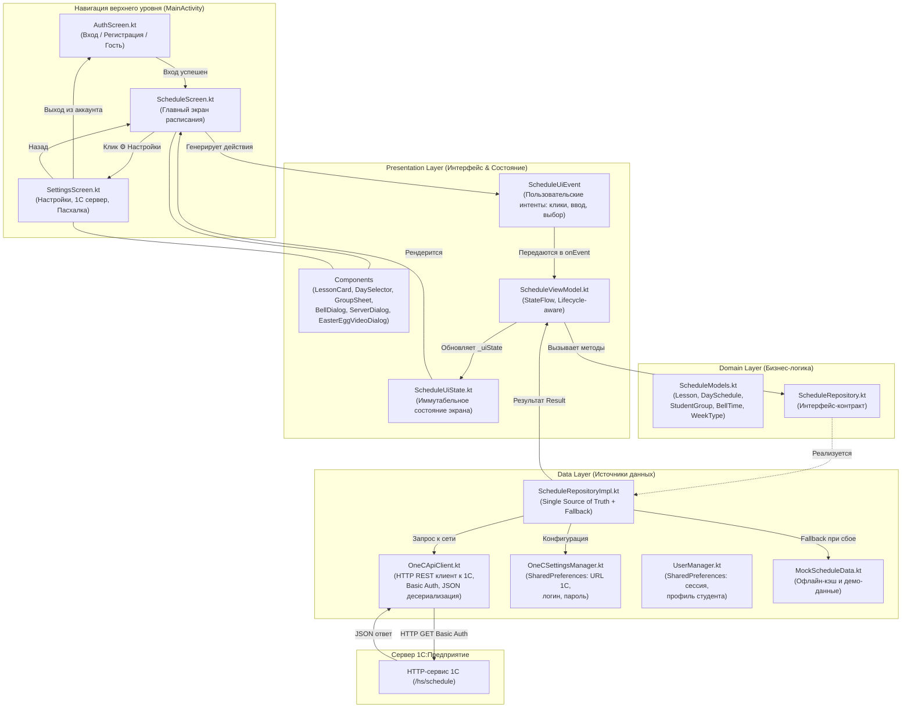

# Архитектурная схема приложения «Тапсырыс» (Clean Architecture + MVI/MVVM)

## 1. Схема слоёв и навигации (Unidirectional Data Flow)

---

## 2. Назначение пакетов и модулей (Где что находится и для чего)

### 📁 `com.TJPK.tapciris.domain` — Слой бизнес-логики (Domain)
- **`model/ScheduleModels.kt`**:
  - `Lesson` — отдельное занятие (номер пары, время, предмет, преподаватель, аудитория, тип, замена).
  - `DaySchedule` — день расписания (название, дата, список пар, флаг замен).
  - `StudentGroup` — учебная группа колледжа (название, курс, специальность).
  - `BellTime` — звонок (номер пары, время начала и окончания, длительность перемены).
  - `WeekType` — перечисление чётности недели (Числитель / Знаменатель).
- **`repository/ScheduleRepository.kt`**:
  - Чистый контракт бизнес-операций: `getGroups()`, `getSchedule()`, `getBells()`, `pingServer()`.

---

### 📁 `com.TJPK.tapciris.data` — Слой данных (Data)
- **`local/UserManager.kt`**:
  - Управление сессией студента (`isLoggedIn()`, `getUserProfile()`, `saveUser()`, `loginAsGuest()`, `logout()`).
- **`local/OneCSettingsManager.kt`**:
  - Сохранение параметров подключения к 1С в `SharedPreferences` устройства.
- **`remote/OneCApiClient.kt`**:
  - Сетевой клиент к 1С:Предприятие с поддержкой Basic Auth и десериализацией JSON.
- **`remote/ServerConfig.kt`**:
  - Модель настроек соединения с 1С (URL, пользователь, пароль, флаг демо/офлайн режима).
- **`mock/MockScheduleData.kt`**:
  - Автономный резерв данных для офлайн-режима и Compose Previews.
- **`repository/ScheduleRepositoryImpl.kt`**:
  - Реализация `ScheduleRepository` с автоматическим fallback на офлайн-кэш.

---

### 📁 `com.TJPK.tapciris.presentation` — Слой интерфейса (Presentation / UI)
- **`auth/AuthScreen.kt`**:
  - Экран входа и регистрации студента при первом запуске (табы Вход/Регистрация, выбор группы, гостевой доступ).
- **`settings/SettingsScreen.kt`**:
  - Экран настроек: профиль студента, параметры уведомлений, настройка подключения к 1С и информация о приложении.
- **`settings/EasterEggVideoDialog.kt`**:
  - Секретный полноэкранный видеоплеер на `AndroidView` + `VideoView`, открывающийся после 15 нажатий на версию приложения.
- **`schedule/ScheduleScreen.kt`**:
  - Главный экран: выбор группы, числитель/знаменатель, горизонтальный календарь дней, список пар.
  - Кнопка 1С удалена из шапки, добавлена кнопка настроек ⚙️.
- **`components/`**:
  - `LessonCard.kt` — карточка пары со статусом «Идёт сейчас» и блоком замен.
  - `DaySelector.kt` — селектор дней недели (Пн–Сб).
  - `GroupSelectSheet.kt` — шторка быстрого выбора группы с поиском.
  - `BellScheduleDialog.kt` — диалог расписания звонков и перемен.
  - `ServerSettingsDialog.kt` — диалог настройки и проверки связи с 1С.

---

### 📁 Точка входа (`MainActivity.kt`)
- Управляет переключением между `AppScreen.AUTH`, `AppScreen.SCHEDULE` и `AppScreen.SETTINGS`.
- Перехватывает системную кнопку "Назад" через `BackHandler`.
