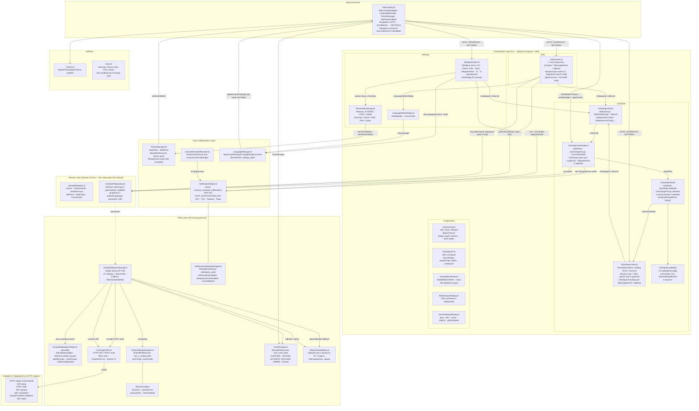

# Архитектурная схема — «Тапсырыс» (Clean Architecture + MVI/MVVM)
> Обновлено: 2026-11-07 | Версия приложения: v0.0.1-concept.4

---

## 1. Обзор: слои и поток данных (Unidirectional Data Flow)

---

## 2. Модуль учетных записей 1С (3 вида аккаунтов)

Приложение поддерживает 3 роли учетных записей, интегрированных с базой 1С:Колледж:

| Роль | `UserRole` | Описание и разграничение доступа | Тестовый логин (1С) |
|------|------------|-----------------------------------|----------------------|
| **Студент** | `STUDENT` | Просмотр расписания **строго своей группы** (жесткая привязка). Переключение чужих групп заблокировано | `student` / пароль `1234` |
| **Преподаватель** | `TEACHER` | Просмотр расписания любых групп, кафедры/отделения. Свободный выбор групп из БД | `teacher` / пароль `1234` |
| **Администратор** | `ADMINISTRATOR` | Полный доступ: управление расписанием, выбор любых групп, настройка сервера 1С | `admin` / пароль `admin` |

---

## 3. Модуль смены темы оформления

### Режимы темы (`ThemeMode`):
- `SYSTEM` — Следовать системной теме устройства (по умолчанию)
- `LIGHT` — Светлая тема
- `DARK` — Тёмная тема

### Цветовые палитры (`ThemePalette`):
- **Классическая** (`DEFAULT`) — Indigo / Deep Purple
- **Изумрудная мята** (`MINT`) — Свежая мятно-зеленая гамма с акцентом Claret
- **Лесная хвоя** (`PINE`) — Хвойный зеленый, Guerrilla Forest и Americana Blue
- **Океанический циан** (`OCEAN`) — Dark Cyan, Alabaster Grey и Deep Evergreen

---

## 4. Модуль уведомлений (Notifications)

- **Канал уведомлений**: `channel_schedule_notifications` (`IMPORTANCE_HIGH`)
- **Android 13+ (API 33+)**: runtime-запрос `POST_NOTIFICATIONS`
- **Напоминания о парах**: за 15 минут до начала занятия
- **Оповещения о заменах**: при обнаружении изменений в 1С
- **Тестовое уведомление**: мгновенная проверка прямо из экрана настроек
- **LessonReminderReceiver**: приёмник сигналов `AlarmManager`

---

## 5. Модуль локальной базы данных (SQLite) и изоляция групп студентов

1. **Автоматическая подгрузка групп из базы 1С в SQLite**:
   - При каждом запуске и по кнопке «Обновить» (`ScheduleUiEvent.Refresh`) репозиторий автоматически запрашивает актуальный список групп из HTTP-сервиса 1С:Колледж (`OneCApiClient.getGroups()`).
   - Свежие группы из 1С автоматически сохраняются и обновляются в локальной SQLite БД (`ScheduleDatabaseHelper.saveGroups()`).
   - Парсер `parseGroupsJson` поддерживает гибкие схемы 1С (`id`, `groupId`, `code`, `Код`, `Наименование`, `Курс`, `Отделение`).
   - При отсутствии сети или сбоях связи группы мгновенно отдаются из локальной БД SQLite.

2. **Подгрузка групп из БД при регистрации**:
   - На экране входа и регистрации (`AuthScreen`) при переключении на вкладку «Регистрация» группы подгружаются напрямую из локальной БД SQLite через `onLoadGroupsFromDb()` (`repository.getGroupsFromDb()`).
   - Студент выбирает свою группу из выпадающего списка `GroupSelectSheet`, получая актуальные данные без ожидания сетевых запросов.
   - Под полем выбора группы выводится статус `«Группы загружаются из базы данных»`.

3. **Изоляция групп для студентов (`canChangeGroup = false`)**:
   - Студент видит **строго и исключительно расписание своей группы** (жесткая привязка к профилю).
   - В `ScheduleUiState` список `groups` фильтруется до единственной группы студента (`groups = listOf(studentGroup)`).
   - В `ScheduleViewModel.onEvent(SelectGroup)` любые попытки переключения чужих групп блокируются (`if (!_uiState.value.canChangeGroup || currentUserRole == UserRole.STUDENT) return`).
   - В интерфейсе `ScheduleScreen` (TopAppBar):
     - Вместо стрелки выпадающего списка отображается иконка замка `Icons.Default.Lock`.
     - Заголовок отображает: `Моя группа: <Название>` (с поддержкой локализации RU, KK, EN).
     - Клик по плашке группы и вызов шторки выбора групп заблокированы.
   - Преподаватели и Администраторы сохраняют свободный доступ ко всем группам колледжа.
